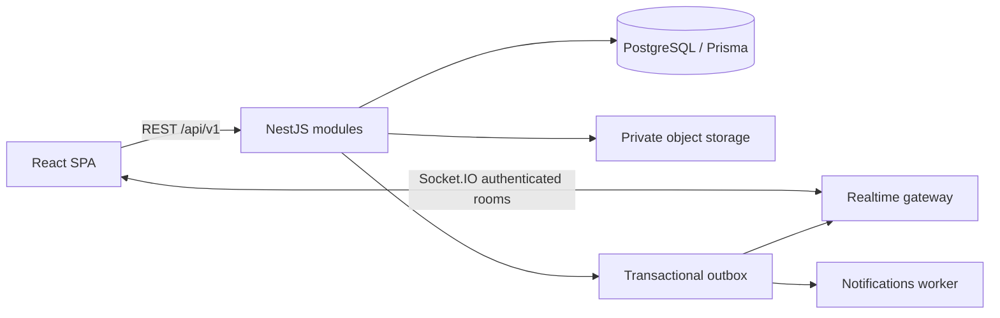

# FieldOps — Architecture وRoadmap

## نطاق Stage 1

تم فحص المستودع: لا توجد ملفات أو commits سابقة. هذه المرحلة تجهّز foundations فقط: npm workspaces، React/Vite/Tailwind، NestJS، Prisma/PostgreSQL، Swagger، health checks، وtest runners. لا توجد مصادقة أو endpoints للأعمال بعد. لا انتقال إلى Stage 2 دون موافقة صريحة.

## المعمارية المقترحة

نختار Modular Monolith: عملية NestJS واحدة ووحدات بحدود واضحة، بدلاً من توزيع مبكر للخدمات. هذا يسمح بـtransactions بسيطة، تطوير أسرع، وفصل وحدات لاحقاً عند ظهور حاجة تشغيلية مقاسة.



Socket.IO وobject storage وoutbox أعلاه تصميم مستقبلي؛ ليست dependencies تشغيلية في Stage 1. قاعدة البيانات هي مصدر الحقيقة. أحداث realtime تحمل IDs وversion، ويعيد العميل جلب الحالة بعد إعادة الاتصال.

## Folder structure

```text
apps/
  api/
    prisma/{schema.prisma,migrations/}
    src/
      main.ts
      app.module.ts
      config/
      prisma/
      health/
    test/
  web/
    src/{App.tsx,main.tsx,styles.css,lib/}
packages/contracts/src/
docs/
compose.yaml
```

عند تنفيذ الميزات: `api/src/modules/<module>/{dto,controllers,services,policies}`، و`web/src/features/<feature>/{api,components,hooks,pages}` مع `web/src/components/ui` للمكونات المشتركة. لا ننشئ وحدات فارغة لإيهام القارئ بأنها مطبّقة. controllers تعالج HTTP، services تنفذ use cases، policies تقرر الوصول، وPrisma يحتفظ بالتخزين خارج طبقة HTTP.

## الوحدات والعلاقات

| Module | المسؤولية والعلاقات |
| --- | --- |
| Authentication | تسجيل الدخول والجلسات وJWT؛ يعتمد على Users وMemberships |
| Users & Roles | الهوية العالمية وعضوية Organization؛ Role ضمن العضوية لا ضمن User عالمي |
| Organizations & Teams | حدود tenant والفرق وعضويات الفنيين |
| Maintenance Requests | طلب Customer، موقعه ووصفه؛ يتحول إلى Work Order بقرار Dispatcher |
| Work Orders | الحالة التشغيلية والأولوية والمواعيد؛ مرجع Assignments والصور والتقدم |
| Assignments | ربط Work Order بفني ومدة التكليف؛ منع تعارض التحديثات عبر transactions/version |
| Tracking | Location samples للفني وسياسة freshness/retention؛ يعتمد على العضوية والتكليف |
| Uploads | metadata في DB وملفات خاصة في object storage، مع فحص MIME والحجم وصلاحية المورد |
| Notifications | أحداث مع retries وidempotency، وتوصيل Socket.IO أو قناة لاحقة |
| Analytics | قراءة مؤشرات مشتقة من Work Orders وAssignments، دون تغيير حالاتها |
| Audit Logs | actor وorganization وaction وresource وtimestamp، دون passwords/tokens |

النموذج المستقبلي: User يمتلك Memberships متعددة؛ Organization تمتلك Teams وMemberships وRequests وWorkOrders. Request له Customer وقد يرتبط بـWorkOrder واحد أو أكثر. WorkOrder له Assignments متعاقبة، StatusHistory وصور. Technician Profile يرتبط بـMembership وليس User وحده. RefreshSession ترتبط بـUser؛ LocationUpdate ترتبط بفني وOrganization. كل مورد tenant يحمل organizationId، مع indexes وقيود composite لمنع الربط بين مؤسستين. Stage 1 يهاجر Organization فقط، وبقية العلاقات تُنفذ في مراحلها.

## قرارات مهمة

- **Authorization:** JWT يثبت الهوية فقط. Guards تفحص العضوية الحالية، وresource policies تتحقق من organizationId وملكية الطلب أو التكليف. Admin مدير مؤسسته وليس مدير كل المؤسسات. Customer يرى طلباته، Technician يرى تكليفاته، Dispatcher يدير موارد مؤسسته. الرفض هو الافتراضي. يلزم اختبار cross-tenant access لكل endpoint.
- **Authentication لاحقاً:** access token قصير العمر في الذاكرة، refresh token عشوائي داخل HttpOnly Secure cookie، hash فقط في DB، rotation وreuse detection وإلغاء session family. CSRF/Origin checks ضرورية لمسارات cookie؛ لا tokens في localStorage.
- **Contracts:** Zod لعقود استجابة React والتحقق من البيانات الخارجية؛ class-validator لطلبات NestJS وSwagger DTOs. حزمة contracts لا تستورد Prisma. حالياً health response أول عقد مشترك؛ لاحقاً نضيف checks لمنع اختلاف OpenAPI وcontracts.
- **REST:** prefix `/api/v1`، pagination محدودة، filters محددة، وUTC timestamps. لاحقاً error envelope ثابت مع code وrequestId وتفاصيل validation آمنة؛ لا stack traces للعميل. Stage 1 يستخدم استثناءات NestJS القياسية و503 آمن للجاهزية.
- **Lifecycle:** Request وWorkOrder حالتان منفصلتان؛ transition policies تمنع إغلاق أو إعادة فتح عشوائي. optimistic concurrency وidempotency keys للعمليات الحساسة.
- **Database:** Prisma migrations محفوظة في Git. `migrate dev` للتطوير و`migrate deploy` للنشر. لا `db push` في production. backup/restore وconnection pooling لازمان قبل النشر.
- **Realtime:** JWT handshake، تحقق العضوية قبل join، rooms حسب Organization ومورد مسموح، لا room names يحددها العميل بحرية. transactional outbox يمنع فقد الحدث بعد commit؛ Redis adapter فقط عند تعدد instances.
- **Maps:** React Leaflet للعرض وOpenStreetMap مع attribution. سياسة tile provider وحدود الاستخدام والتخزين المؤقت تُراجع قبل production. location بيانات حساسة مع صلاحيات وretention وموافقة واضحة.
- **Uploads:** presigned URLs قصيرة العمر وتخزين خاص، ولا مسارات يرسلها العميل. antivirus وlimits قبل إتاحة الملف.
- **Configuration:** `.env` غير متعقب، أمثلة محلية فقط، fail-fast validation، CORS origin محدد، Swagger متاح خارج production فقط. Helmet لا يغني عن TLS/rate limiting وإدارة secrets في النشر.
- **Frontend:** feature-based composition، server state لاحقاً عبر TanStack Query، responsive RTL، ومكونات UI مستقلة عن business logic. إخفاء الزر ليس بديلاً عن authorization في API.

## Roadmap وحدود القبول

1. **Stage 1 — Foundations (الحالية):** bootable frontend/backend، PostgreSQL، migration أولية، Swagger، build/typecheck وsmoke tests.
2. **Stage 2 — Identity & tenancy:** Users/Memberships/Teams، JWT/refresh rotation، RBAC وresource policies؛ قبولها يتطلب اختبارات العزل والإلغاء وrefresh reuse.
3. **Stage 3 — Service lifecycle:** Requests وWorkOrders وAssignments، transitions، concurrency، قوائم ونماذج؛ اختبارات workflow كاملة.
4. **Stage 4 — Field operations:** تحديث التقدم والصور، React Leaflet، location ingestion وSocket.IO، outbox وnotifications؛ اختبارات reconnect والصلاحيات.
5. **Stage 5 — Visibility:** analytics وaudit querying، filters وpagination وسياسة retention.
6. **Stage 6 — Production hardening:** E2E واختبارات load، CI/CD، rate limits، observability، backup restoration، security review وdeployment.

كل مرحلة تتطلب موافقة مستقلة. أي شاشة تعرض business data أو login فعلي تقع خارج Stage 1.
