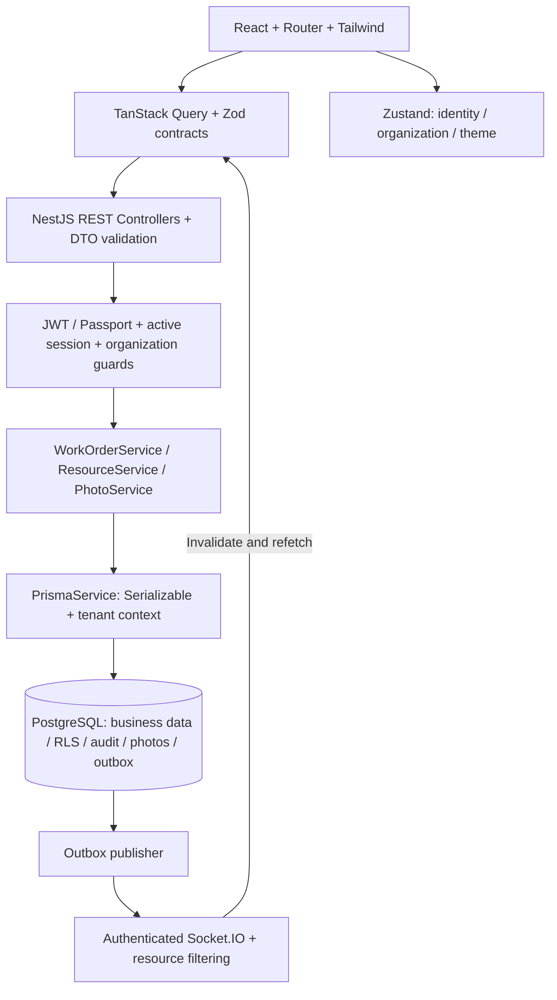

# مراجعة المشروع بعد Stage 5

## أين وصلنا؟

| المرحلة | الحالة الفعلية |
| --- | --- |
| Stage 1 | Monorepo وأساس React/NestJS، PostgreSQL/Docker Compose، configuration وSwagger |
| Stage 2 | Prisma models وmigrations وseed، UUID/composite foreign keys، tenant isolation وRLS |
| Stage 3 | Argon2، JWT/Passport، refresh rotation/revocation، RBAC وresource authorization، اختبارات |
| Stage 4 | Design system وshell وLogin/Registration وOverview حسب الدور وlists وresponsive light/dark themes؛ لم تُنفّذ الصفحات الاثنتا عشرة كلها دفعة واحدة |
| Stage 5 | دورة الصيانة كاملة عبر REST والواجهة، الصور والتقدم وإعادة التعيين والإلغاء والتحقق والإغلاق، authenticated Socket.IO وnotifications وactivity history |

المشروع أصبح تطبيق تشغيل متصلاً بقاعدة بيانات، يمكن تنفيذ دورة صيانة كاملة فيه بين ثلاثة مستخدمين بأدوار مختلفة. صفحات Live GPS وAnalytics/Reports وProfile/Settings المتقدمة ما زالت أعمالاً لاحقة؛ ليست ضمن إنجاز Stage5 ولا تظهر كروابط عاملة وهمية. لم تبدأ مرحلة جديدة تلقائياً.

## المعمارية الحالية



**حدود المسؤوليات:** Controllers تستقبل الطلبات وDTOs؛ Guards تثبت الهوية والعضوية؛ Services تتحقق من ملكية المورد والحالة وتنفذ transaction؛ PrismaService يفرض tenant context وisolation؛ PostgreSQL يفرض RLS وFKs وunique constraints. الواجهة لا تمنح الصلاحيات ولا تعيّن حالة العمل من event payload.

```text
apps/api/
  prisma/schema.prisma + migrations/ + seed.cjs
  src/auth/                   JWT, sessions, refresh, guards, decorators
  src/prisma/                 scoped database transactions
  src/resources/              REST resources, visibility policy
  src/work-orders/            lifecycle, assignment, progress, image processing
  src/realtime/               durable events, authenticated gateway, publisher
  test/integration/           database, authentication, workflow, Socket.IO
apps/web/src/
  components/                 shared shell and accessible UI primitives
  features/auth/              Login / Registration
  features/operations/        Overview / searchable lists
  features/workflow/          Requests / details / commands / photos / notifications
  services/                   HTTP, Zod contracts, isolated mocks
  state/                      lightweight session and UI state
packages/contracts/           shared contracts foundation
compose.yaml                  PostgreSQL development service
```

## مراجعة القرارات

- **Organization isolation:** RLS على الجداول الجديدة والقديمة، مع فحوص ownership في الخدمات. مشاركة نفس المؤسسة لا تعني حق مشاهدة كل طلب أوعمل.
- **Concurrency:** `expectedVersion` وSerializable transactions يمنعان كتابة حالة قديمة؛ partial unique index يمنع duplicate active assignments. الخطأ409 يؤدي لإعادة القراءة، ولا يُعاد تنفيذ الأمر تلقائياً.
- **Database as source of truth:** كتابة event ضمن نفس transaction تمنع إرسال نجاح عن تغيير لم يُحفظ. Socket.IO يطلب refetch فقط، وإعادة الاتصال والـ30s synchronization تعالجان فقدان الأحداث.
- **Compatibility:** بقيت المصادقة وdesign system والـmock adapter. ترحيل البيانات السابقة يحفظ الأعمال قيد التنفيذ ويسجل قبولاً مستنتجاً بشكل معلن في AuditLog، دون حذف السجل.
- **Private images:** تحقق من signature وفك الصورة وإعادة ترميزها، حد حجم وعدد وpixels، ثم حفظ metadata/bytes ذرّياً. لا public file paths ولا استعمال أسماء ملفات العميل للتخزين.
- **Frontend:** صفحات مستقلة؛ useCommand يجمع error/invalidation، وPhoto يعزل Blob lifecycle، وuseRealtime يعزل اتصال المؤسسة. لا server state داخل Zustand ولا credentials في localStorage.
- **Verification:** اختبارات PostgreSQL وHTTP وWebSocket والمتصفح تشمل مستخدمين فعليين بأدوار مختلفة؛ [نتائج التحقق](validation.ar.md) تسجل النتائج وحدودها.

## الحدود التي تبقى قبل production والتوسع

1. Gateway وoutbox delivery يدعمان API instance واحدة؛ نحتاج shared adapter/delivery design وshared rate-limit store عند التوسع.
2. صور DB مناسبة للأحجام المحدودة الحالية. الانتقال إلى private object storage يحتاج upload finalization وretention وbackup strategy.
3. القوائم حتى100 سجل؛ server-side pagination/filtering والتقارير الكبيرة عمل لاحق.
4. `npm audit --omit=dev` ما زال يبلغ عن14 تنبيهاً:13 high و1 moderate في التبعيات، بما فيها تحذيرات Prisma/NestJS وتبعياتهما. حُدّث sharp إلى0.35.5؛ لم نفترض أن نجاح الاختبارات يزيل تنبيهات dependencies. معالجة هذه النتائج مطلوبة قبل إعلان جاهزية production.
5. Email verification وpassword reset وMFA وGPS/Analytics وإدارة الحساب المتقدمة لم تدخل هذه الدفعة.

نطاق Stage5 الوظيفي مكتمل ومختبَر. الانتقال للمرحلة التالية يبنى على هذه النسخة، ولا يتطلب إعادة تأسيس المشروع. [تفاصيل business logic وevent flow والتشغيل](workflow.ar.md).
