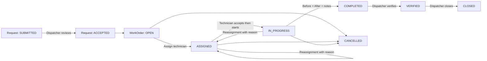
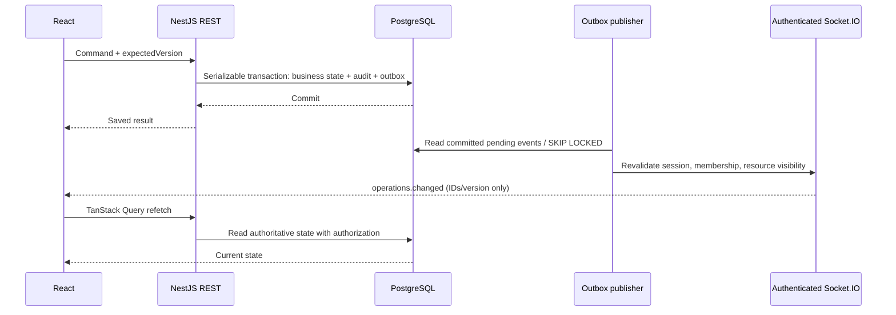

# Stage 5 — دورة الصيانة والتحديثات الفورية

تنفيذ هذه المرحلة يصل Customer وDispatcher وTechnician ببيانات PostgreSQL الحقيقية. بقيت بنية NestJS وPrisma وReact الموجودة، وأُضيفت عليها أوامر الأعمال وواجهاتها. التشغيل الافتراضي للواجهة الآن API؛ `VITE_DATA_SOURCE=demo` يبقى معاينة مستقلة لا تنفّذ عمليات فعلية.

## قواعد الأعمال



- **Request** يملكه Customer داخل Organization. يؤخذ `customerId` من العضوية المصادق عليها، وليس من body. مراجعة الطلب عملية صريحة تسجل المراجع والوقت والملاحظة و`version`؛ لا يُنشأ WorkOrder قبل قبول الطلب.
- يمكن أن ينتج الطلب أكثر من WorkOrder لأعمال مستقلة. يصبح `RESOLVED` حين تكون كل الأعمال `CLOSED` أو`CANCELLED` ويوجد عمل مغلق واحد على الأقل. إلغاء جميع الأعمال وحده يبقي الطلب مقبولاً لإعادة التخطيط، ويمكن للموظف إلغاء الطلب صراحة.
- **Assignment** يمثل تكليفاً تاريخياً لا يُحذف. يوجد تكليف `ACTIVE` واحد فقط لكل WorkOrder. قبول الفني يُسجّل في `acceptedAt` ويزيد `version` دون اختراع حالة WorkOrder جديدة.
- الفني المكلّف وحده يقبل المهمة ويبدأها ويرفع الصور ويحدّث التقدم ويكملها. لا يستطيع Dispatcher إكمال العمل نيابة عنه. Admin وDispatcher يراجعان الطلبات ويعينان الفنيين ويتحققان من الأعمال ويغلقانها أويلغيانها.
- التقدم بين 0 و99 أثناء العمل، لا يتناقص داخل التكليف الحالي، ويحتاج ملاحظة. الإكمال يضبطه إلى100 ويتطلب Completion notes وصورتي `BEFORE` و`AFTER` مرتبطتين **بالتكليف الحالي**.
- إعادة التعيين تحتاج سبباً؛ تنهي السابق بحالة `REASSIGNED` وتعيد WorkOrder إلى`ASSIGNED` وتصفّر التقدم. على الفني الجديد القبول وتقديم صور جديدة. تبقى صور وتقدم وتاريخ التكليف السابق محفوظة.
- إلغاء الطلب يلغي كل الأعمال غير المنتهية وتكليفاتها في transaction واحدة. يحق للعميل إلغاء طلبه قبل المراجعة فقط. وجود عمل مكتمل أوتم التحقق منه أوإغلاقه يمنع إلغاء الطلب بالجملة. إلغاء WorkOrder يحتاج سبباً، والحالات النهائية لا تُفتح مجدداً.
- يستطيع Technician قراءة تكليفاته النشطة أوالمكتملة أوالملغاة للاحتفاظ بالسجل؛ يفقد الوصول فور إعادة التعيين. يستطيع Customer متابعة WorkOrders المرتبطة بطلباته فقط.

التحديث يحافظ على الأعمال القديمة التي بدأت قبل وجود أمر القبول: migration تستنتج `acceptedAt` من سجل بدء العمل أووقت التعيين، وتسجل `LEGACY_ACCEPTANCE_BACKFILLED` مع `inferred: true` في AuditLog. هذا ترحيل تاريخي معلن وليس ادعاء بأن الفني ضغط زر قبول جديد.

## لماذا Transactions وversion معاً؟

كل تغيير يكتب WorkOrder/Assignment وActivity history وAuditLog وNotification وOutbox داخل نفس Prisma transaction. `PrismaService.forOrganization` يستخدم `Serializable` ويضبط tenant context و`SET LOCAL ROLE fieldops_app`؛ PostgreSQL RLS يعزل صفوف المؤسسة، والخدمات تفحص الدور وملكية المورد.

العميل يرسل `expectedVersion` مع assignment/accept/status/progress/photos وrequest review. التحديث مشروط بالإصدار؛ الطلب القديم يفشل بـ`409` ويُطلب إعادة تحميل البيانات. تعارض `Serializable` يتحول أيضاً إلى409، ولا نعيد تشغيل أمر المستخدم تلقائياً. Partial unique index على Assignment يمنع تكليفين نشطين حتى لو تجاوز كود آخر فحص الخدمة. Composite foreign keys تضمن أن الصورة/التقدم والتكليف تعود إلى نفس المؤسسة ونفس WorkOrder.

إن فشل التحقق من الحالة أوالصلاحية أوالإصدار، تُلغى كل الكتابات بما فيها الأحداث والإشعارات. لا توجد optimistic state transitions في React؛ تعرض الواجهة النتيجة بعد موافقة الخادم وتعيد قراءة البيانات.

## REST API

جميع المسارات التالية تبدأ بـ`/api/v1/organizations/:organizationId` وتتطلب Bearer access token وعضوية نشطة.

| Method / path | الغرض / الدور |
| --- | --- |
| `POST /requests` | إنشاء طلب للعميل الحالي |
| `GET /requests`, `GET /requests/:id` | Inbox للموظف، طلبات مملوكة للعميل |
| `POST /requests/:id/review` | Staff؛ `expectedVersion`, `note` |
| `POST /requests/:id/cancel` | Staff أوصاحب الطلب قبل المراجعة؛ `reason` |
| `POST /work-orders` | Staff؛ `requestId`, `title`, `description` |
| `GET /work-orders`, `GET /work-orders/:id` | List/detail ضمن صلاحيات المورد |
| `GET /technicians` | Staff؛ الفنيون النشطون بالمؤسسة |
| `POST /work-orders/:id/assignments` | Staff؛ `technicianId`, `expectedVersion`, reason عند إعادة التعيين |
| `POST /work-orders/:id/accept` | الفني المكلّف؛ `expectedVersion` |
| `PATCH /work-orders/:id/status` | `status`, `expectedVersion`, `reason`؛ تستخدم reason كملاحظات الإكمال |
| `POST /work-orders/:id/progress` | الفني؛ `percent`, `note`, `expectedVersion` |
| `POST /work-orders/:id/photos` | multipart: `file`, `kind`, `expectedVersion` |
| `GET /photos/:id/content` | محتوى الصورة ضمن صلاحية WorkOrder |
| `GET /notifications` | إشعارات العضوية الحالية، الأحدث أولاً |
| `PATCH /notifications/:id/read` | تعليم إشعار مملوك للمستخدم كمقروء |

Swagger في `/api/docs` يصف DTOs وBearer وmultipart. `GET /work-orders/:id` يعيد assignments وstatusHistory وprogressUpdates وattachments metadata وactivity مع أسماء أصحاب الأحداث. القوائم الحالية محدودة بأحدث100 سجل؛ البحث والpagination في الواجهة محليان ضمن هذا النطاق.

## الصور

الرفع متاح بعد قبول المهمة؛ `AFTER` تتطلب `IN_PROGRESS`. الملفات JPEG/PNG/WebP بحد5MiB و20 مليون pixel، و20 صورة كحد أقصى للتكليف. `sharp` يفك الصورة ويصحح الدوران ويصغّرها إلى2048px ويعيد ترميزها WebP دون metadata الأصلية. لا يُستخدم اسم الملف القادم من العميل كمسار.

`Attachment` يحتفظ بالبيانات الوصفية، و`PhotoContent` يحتفظ بالـbytes في جدول منفصل محمي بـRLS. هذا قرار مرحلي مقصود لتحقيق ذرية رفع الصورة مع تغيير الإصدار والحدث، دون ملفات يتيمة أوpublic URLs. الإرجاع يتطلب Bearer وصلاحية المورد، مع`private, no-store`. React ينشئ Blob URL مؤقتاً ويلغيه عند unmount. القوائم لا تحمل bytes. الأحجام الكبيرة مستقبلاً تحتاج private object storage وupload finalization، وليست جزءاً من هذه المرحلة.

## تدفق Socket.IO



- الاتصال عبر namespace `/operations` وtransport path `/api/socket.io`، مع`auth: { token, organizationId }`. التوكن في ذاكرة العميل، وليس query string أوlocalStorage.
- Gateway يتحقق من Origin المطابق لـ`WEB_ORIGIN`، توقيع JWT/issuer/audience/expiry والجلسة غير الملغاة والعضوية النشطة. يضيف socket إلى`org:<organizationId>` من جهة الخادم. لا يوجد join-room أوأوامر أعمال يرسلها العميل عبر WebSocket؛ تغييرات الأعمال تمر عبر REST.
- الغرفة تحدد الجمهور المحتمل فقط: قبل كل إرسال نتحقق مجدداً من الجلسة والعضوية وملكية المورد. فني آخر أوعميل آخر داخل نفس المؤسسة لا يتلقى معرفات عمل غير مسموح له. Notification تذهب إلى recipient فقط. يفحص الخادم الاتصالات الخاملة كل15ثانية ويقطع الجلسات المنتهية/الملغاة.
- الحدث `operations.changed` يحمل `id`, `aggregateType`, `aggregateId`, `eventType`, `version` فقط. الإشعار الفعلي وسجل العمل محفوظان في DB. إعادة التعيين تنشئ إشعاراً للفني السابق أيضاً كي يعيد تحميل قائمته بعد فقدان الصلاحية.
- Outbox publisher يقرأ دورياً كل500ms باستخدام `FOR UPDATE SKIP LOCKED`. الفشل يعيد المحاولة؛ التكرار ممكن، لذلك يحتفظ العميل بذاكرة محدودة لمعرفات الأحداث التي استقبلها. `publishedAt` يعني أن محاولة البث أُنجزت، وليس أن كل متصفح أكد الاستلام.
- في كل اتصال/إعادة اتصال يرسل الخادم `sync.required`. العميل يبطل Query cache ويعيد قراءة REST، ويزامن أيضاً كل30ثانية وعند عودة الشبكة. عند انتهاء access token يجدد الجلسة ثم يتصل مجدداً. لا يوجد اعتماد على اكتمال ترتيب الأحداث أوreplay cursor، ولا تعديل محلي لحالة العمل من payload الحدث.

**حدود التشغيل:** النسخة الحالية مناسبة لـAPI instance واحدة. تشغيل عدة instances يحتاج Socket.IO shared adapter وتصميماً يضمن وصول أحداث الـoutbox لجميع العقد؛ `SKIP LOCKED` وحده لا يكفي للبث بين العقد. المخزن الحالي للـrate limit أيضاً محلي. ملفات الصور وأحداث outbox تحتاج retention/backup policy قبل توسع التخزين.

## Component architecture

- `features/workflow/Requests.tsx` و`RequestDetails.tsx` و`WorkOrderDetails.tsx`: صفحات مستقلة للطلبات والأعمال؛ تعيد استخدام Button/EmptyState/ErrorState والـdesign tokens. `useCommand.ts` يجمع mutation/invalidation/errors، و`Photo.tsx` يعزل تحميل الصور وتنظيف Blob URLs.
- `services/workflow.ts`: عقود Zod للقراءة وtyped command adapter. `http.ts` يدعم FormData دون إجبار Content-Type ويحافظ على single-flight refresh.
- `features/workflow/useRealtime.ts`: اتصال واحد للمؤسسة الحالية، cleanup عند تبديل المؤسسة/logout، invalidation وdeduplication وfallback sync.
- `features/workflow/Notifications.tsx`: Query لإشعارات المستخدم وMutation لتعليم المقروء.
- Zustand يحتفظ بالهوية والمؤسسة والثيم فقط؛ TanStack Query يحتفظ بحالة الخادم. لا تنتقل mock data إلى خدمات API.

## التشغيل والتحقق

```bash
npm ci
npm run db:generate
docker compose up -d --wait
npm exec -w @fieldops/api -- prisma migrate deploy
npm run dev
```

`WEB_ORIGIN` يجب أن يطابق عنوان الواجهة الفعلي. Vite يمرر HTTP وWebSocket عبر`/api`؛ production reverse proxy يجب أن يدعم Upgrade على`/api/socket.io`. لا حاجة لمتغير frontend secret.

```bash
npm run typecheck
npm test
npm run build
# اضبط TEST_DATABASE_URL لقاعدة مستقلة ينتهي اسمها بـ_test، ثم:
npm run test:integration -w @fieldops/api
npm run test:e2e -w @fieldops/web
npm run test:e2e:api -w @fieldops/web
# عند استخدام Chromium المثبت بدلاً من تنزيل Playwright:
PLAYWRIGHT_CHROMIUM_EXECUTABLE=/usr/bin/chromium npm run test:e2e:api -w @fieldops/web
npm run db:studio -w @fieldops/api
```

اختبارات integration وAPI browser تتطلب PostgreSQL حقيقياً وقاعدة`_test` مخصصة، ولا تحذف قاعدة التطوير. Studio اتصال owner محلي لمراجعة البيانات، وليس واجهة آمنة لعملاء المؤسسات. افتح WorkOrder ثم Assignment/ProgressUpdate/Attachment/PhotoContent/AuditLog/OutboxEvent لمقارنة الحالة والسجل.

لتجربة الأدوار: التسجيل العام ينشئ Admin ومؤسسة جديدة فقط كما في Stage3. أضف المستخدمين المسجلين مسبقاً إلى المؤسسة عبر`POST /users` بصلاحية Admin واختر الدور؛ لا تمنح الواجهة العامة حق اختيار دور مرتفع. Seed لا يضيف كلمات مرور افتراضية.

Live GPS tracking وAnalytics والتوسع متعددالعقد ليست ضمن Stage5، ولم يبدأ تنفيذ مرحلة جديدة.
